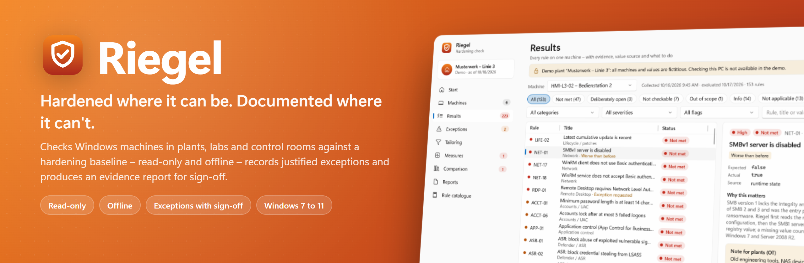
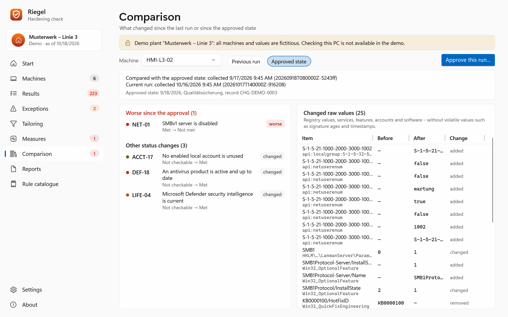
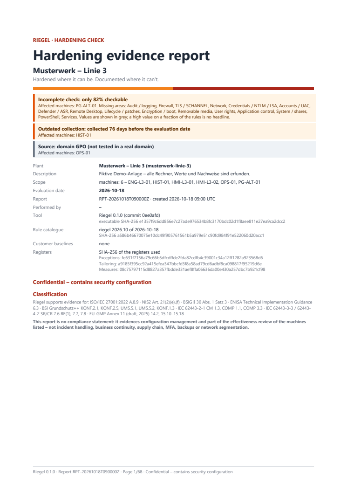

<p align="center">
  
</p>

<p align="center">
  <a href="https://github.com/ict-baden/riegel/releases/tag/latest"></a>
  
  
  
  
  
  
  
  
  <a href="https://github.com/ict-baden/riegel/actions/workflows/build.yml"></a>
</p>

<p align="center">
  <b><a href="https://github.com/ict-baden/riegel/releases/tag/latest">Download</a></b>
  &nbsp;·&nbsp; <a href="#what-riegel-does">Features</a>
  &nbsp;·&nbsp; <a href="#quick-start">Quick start</a>
  &nbsp;·&nbsp; <a href="#the-rule-catalogue">Rules</a>
  &nbsp;·&nbsp; <a href="#documentation">Documentation</a>
  &nbsp;·&nbsp; <a href="#limits-honestly">Limits</a>
</p>

<br>

<p align="center">
  <b>Evidence of hardening for the Windows machines nobody manages centrally.</b><br>
  Riegel reads the security configuration of plant, lab and control-room PCs without changing their configuration, checks it
  against 153 rules,<br>keeps what is deliberately open as justified and approved exceptions, and writes a report to sign.
</p>

> [!IMPORTANT]
> **The MSI is not the way onto OT or validated machines.** Installing software there is a change in itself. On plant
> PCs run the **portable collector** (`Riegel-Collector.zip`: installs nothing, changes no configuration and writes only
> its export; Windows itself records that a program ran – [what it leaves behind](docs/collector.md#what-it-leaves-behind)) or Windows' own
> **built-in commands**, and evaluate the snapshot on an analysis PC. The MSI is for admin, engineering and auditor
> PCs. **Not code-signed yet:** no customer pilot on OT or validated machines with this unsigned 0.1 version.

> [!NOTE]
> **Deutsch:** Riegel (Härtungs-Check) prüft Windows-Rechner in Anlagen, Laboren und Leitständen lesend und offline
> gegen ein eigenes Härtungs-Regelwerk mit 153 Regeln. Was nicht gehärtet werden kann, wird als begründete Ausnahme mit
> Freigabe festgehalten, Zuschnitt und Maßnahmenplan inklusive; am Ende stehen ein Bericht zum Abzeichnen (PDF), Excel,
> ein Nachweispaket mit `verify` und Abhilfe-Dateien für den Anlagenbauer. Riegel ändert auf den geprüften Rechnern
> keine Konfiguration; der Sammler schreibt nur seinen Export, und Windows selbst vermerkt, dass ein Programm lief
> ([was bleibt](docs/collector.md#what-it-leaves-behind)). **Die MSI ist nicht der Weg auf OT-Rechner:** dort läuft nur der portable Sammler ohne Installation.
> Oberfläche und Berichte gibt es auf Deutsch, Englisch, Spanisch, Französisch und Chinesisch (die letzten drei
> maschinell vorübersetzt); diese Dokumentation ist englisch.

## What Riegel does

<table>
  <tr>
    <td width="33%" valign="top">
      <picture>
        <source media="(prefers-color-scheme: dark)" srcset="docs/assets/screenshots/results-dark.png">
        
      </picture>
      <br><b>153 rules, honest results</b><br>
      Network, credentials, Defender and ASR, application control, encryption, firewall, audit, RDP, removable media, TLS. A pass needs positive evidence; what could not be read is <i>not checkable</i>, never a silent pass.
    </td>
    <td width="33%" valign="top">
      <picture>
        <source media="(prefers-color-scheme: dark)" srcset="docs/assets/screenshots/exceptions-dark.png">
        
      </picture>
      <br><b>Deliberately open, approved</b><br>
      Exceptions with a justification, the accepted value, an approving role and a change or QMS record – bound to their content, with expiry and history. Tailoring per role and a measures plan beside them.
    </td>
    <td width="33%" valign="top">
      <picture>
        <source media="(prefers-color-scheme: dark)" srcset="docs/assets/screenshots/comparison-dark.png">
        
      </picture>
      <br><b>What changed since approval?</b><br>
      Comparison with the previous run and with the approved state after commissioning or a vendor visit: worse first, then raw-value drift.
    </td>
  </tr>
  <tr>
    <td valign="top">
      <picture>
        <source media="(prefers-color-scheme: dark)" srcset="docs/assets/screenshots/machines-dark.png">
        
      </picture>
      <br><b>A plant folder, not a server</b><br>
      Machines, groups and roles, snapshots, runs and registers as readable JSON files in one folder – on a stick, a share or under the customer's change control.
    </td>
    <td valign="top">
      <picture>
        <source media="(prefers-color-scheme: dark)" srcset="docs/assets/screenshots/reports-dark.png">
        
      </picture>
      <br><b>Documents to sign</b><br>
      Plant report with sign-off that binds the register versions, one-page summary, target configuration, approval sheet, collection record, Excel, CSV and an evidence ZIP that auditors re-check with <code>verify</code>.
    </td>
    <td valign="top">
      
      <br><b>Remediation as files only</b><br>
      <code>.reg</code> with a rollback, <code>GptTmpl.inf</code> and <code>audit.csv</code> for the plant vendor – never applied by Riegel, excepted and tailored rules left out.
    </td>
  </tr>
</table>

### And also

- **Runs offline, installs nothing on the target:** a ~130 KB collector for Windows 7 SP1 to 11 and Server 2008 R2 to
  2025 (.NET Framework 3.5.1 or 4.x; older systems through the built-in commands), deterministic builds, AppLocker hash data and a published read-only proof per
  build; `--minimal` for sensitive HMIs starts no other program.
- **Runtime before configuration:** SMB, VBS/HVCI/Credential Guard, LSA protection, firewall and Defender are read from
  their running state first; cited OS defaults are flagged "Default value assumed" (*Standardwert angenommen*).
- **Monitoring that alerts on change:** Nagios exit codes and an Icinga line for regressions, newly open high findings,
  expiring exceptions and overdue measures – not for the standing state.
- **Auditors on Linux:** `riegel-linux-x64` re-evaluates evidence packs (`verify`) and compares a fresh collection with
  a packed snapshot (`compare-snapshot`); it needs OpenSSL, ICU and a font from the system
  ([Linux packages](docs/installation.md#linux-packages)).
- **Customer baselines:** import GPO backups (including the ones inside downloaded security baselines) or write your
  own requirements as `riegel.baseline/1` JSON or CSV.
- **Machine builders:** an *as-delivered* report preset with machine identity and the justified deviations of the
  machine's software; `Riegel.Cli.exe check` in the FAT pipeline.

## Quick start

<table>
  <tr>
    <td width="33%" valign="top"><b>① Collect</b><br>Copy <code>Riegel-Collector.zip</code> to a stick, run <code>Riegel.Collector.exe</code> on the plant PC (as administrator for a complete result). It writes one snapshot file next to itself.</td>
    <td width="33%" valign="top"><b>② Import</b><br>On an analysis PC, open or create a plant folder in <code>Riegel.exe</code> and drop the snapshot onto <i>Import exports</i> – or use <code>Riegel.Cli.exe import</code>.</td>
    <td width="33%" valign="top"><b>③ Justify and sign</b><br>Work through the open findings, record deliberate exceptions with their approval record, and write the plant report on the <i>Reports</i> page.</td>
  </tr>
</table>

**Downloads** – from the release [**latest**](https://github.com/ict-baden/riegel/releases/tag/latest) (newest build of
`main`). **For OT machines take a tag release, never `latest`**: the collector's hash, its AppLocker data and its
read-only proof belong to that release.

| File | What it is |
|---|---|
| **[Riegel-Collector.zip](https://github.com/ict-baden/riegel/releases/download/latest/Riegel-Collector.zip)** | portable collector for plant and older machines, plus `collect-builtin.cmd`; installs nothing |
| **[Riegel-x64.msi](https://github.com/ict-baden/riegel/releases/download/latest/Riegel-x64.msi)** | analysis app with `Riegel.Cli.exe` and the collector, for all users (`msiexec /i Riegel-x64.msi /qn`, Intune, GPO) – **not for OT machines** |
| [Riegel.exe](https://github.com/ict-baden/riegel/releases/download/latest/Riegel.exe) | the app as one file, no installation (without the collector) |
| [riegel-win-x64.exe](https://github.com/ict-baden/riegel/releases/download/latest/riegel-win-x64.exe) · [riegel-linux-x64](https://github.com/ict-baden/riegel/releases/download/latest/riegel-linux-x64) · [riegel-linux-arm64](https://github.com/ict-baden/riegel/releases/download/latest/riegel-linux-arm64) | command line as one file for scripts, FAT pipelines and auditors |
| [SHA256SUMS.txt](https://github.com/ict-baden/riegel/releases/download/latest/SHA256SUMS.txt) | checksums – the builds are **not code-signed** yet, check them ([how](docs/installation.md#verifying-the-download)) |

All files, the framework ZIP, the AppLocker data, the read-only proof and the SBOM: **[Installation →](docs/installation.md)**.
Want to look around first? **`Riegel.exe --demo`** opens the fictitious plant "Musterwerk – Linie 3".

### From the command line

Use `Riegel.Cli.exe` (or `riegel-win-x64.exe`, `riegel-linux-x64`) in scripts – `Riegel.exe` is a window program and a
console does not wait for it.

```powershell
# Collect this PC (Windows 10 1809 / Server 2019 or later; older machines: the portable collector)
Riegel.Cli.exe collect --out D:\Exporte

# Evaluate a snapshot without a plant (exit code 0 OK, 1 warning, 2 critical, 3 error)
Riegel.Cli.exe check --snapshot D:\Exporte\HMI-01_20261018T080000Z.snapshot.json

# A plant: import every export in D:\Exporte with collection record, report, evidence pack – and verify it like an auditor
Riegel.Cli.exe plant init D:\Riegel\Linie3 --name "Linie 3"
Riegel.Cli.exe import D:\Exporte --plant D:\Riegel\Linie3 --collected-by-role Servicetechniker --witness-role Anlagenverantwortlicher --record
Riegel.Cli.exe report --plant D:\Riegel\Linie3 --format pdf,xlsx --evidence --out D:\Berichte
riegel-linux-x64 verify Riegel-Evidence_Linie-3_2026-10-18.zip

# Monitoring against the plant (scheduled task, Icinga): one line; with --plant the alert mode is "change", so the
# exit code reports what got worse, expiring exceptions and overdue measures – not the permanent state
Riegel.Cli.exe check --snapshot D:\Exporte\HMI-01_20261019T080000Z.snapshot.json --plant D:\Riegel\Linie3 --brief
```

```text
RIEGEL WARNING - HMI-01: 0 worse, 3 open (1 high), 1 exception expiring, 1 measure overdue | score=72%;;;0;100 open=3 high=1 regressions=0 expiring=1 overdue=1 notcheckable=4
```

Every command, the alert modes and a scheduled-task and Icinga example: **[Command line →](docs/command-line.md)**.

## The rule catalogue

Catalogue **2026.10** has **153 rules** in 17 report categories, with texts written by ICT-Baden. Every expected value
is backed by ACSC (CC BY 4.0), the CC BY 4.0 Microsoft Windows Server documentation, a Microsoft Learn fact page or a
DISA STIG; Microsoft Security Baselines only corroborate (document and setting name, never a value). References name
MITRE ATT&CK mitigations and Grundschutz++ identifiers. The catalogue contains **no CIS and no BSI SiSyPHuS content**.

| Category | Rules | | Category | Rules |
|---|---|---|---|---|
| Lifecycle / patch | 5 | | Defender / ASR | 16 |
| Network | 16 | | Application control | 3 |
| Credentials / NTLM / LSA | 17 | | Encryption / boot | 7 |
| Logon | 2 | | Firewall | 11 |
| Accounts / UAC | 13 | | Services, system / shares | 5 |
| User rights | 3 | | Audit / logging, PowerShell | 29 |
| | | | Remote Desktop, removable media, TLS | 26 |

Every rule with its sources: **[Rule catalogue →](docs/rules.md)** · how a result is decided: **[Evaluation →](docs/evaluation.md)**.

## Documentation

| Page | Content |
|---|---|
| [Installation](docs/installation.md) | which package for which machine, MSI `/qn`, Intune and GPO, scheduled tasks and SYSTEM on a share, SmartScreen, checksums |
| [Portable collector](docs/collector.md) · [Change-request pack](docs/collector-change-request.md) | USB and share workflow, built-in commands, .NET pre-check, AppLocker, traces, the read-only proof; every item read and process started |
| [Using the app](docs/usage.md) · [Settings](docs/settings.md) | every page with screenshots, keyboard, demo; settings and machine-wide presets |
| [Command line](docs/command-line.md) | commands, exit codes and alert modes, Icinga, scheduled tasks, FAT pipelines, auditors on Linux |
| [Exceptions, tailoring and measures](docs/exceptions.md) | the three registers, approval binding, templates, history |
| [Evaluation](docs/evaluation.md) · [Scoring and comparison](docs/scoring-and-comparison.md) | evidence rules for auditors; scores, audit cap, comparison and drift |
| [Reports](docs/reports.md) · [Evidence pack](docs/evidence.md) · [Remediation](docs/remediation.md) | PDF documents with example pages, Excel and CSV, `verify` and `compare-snapshot`, remediation files |
| [Customer baselines](docs/baselines.md) | GPO backups, `riegel.baseline/1` JSON and CSV |
| [Rule catalogue](docs/rules.md) · [Rule sources](docs/rule-sources.md) · [Frameworks](docs/frameworks.md) | all 153 rules, sources and licences, what Riegel supports evidence for |
| [Data and privacy](docs/data-and-privacy.md) | every file and field, deleting, pseudonymisation, works council, no network |
| [Limitations](docs/limitations.md) | what 0.1 does not do and what is only tested on CI runners |
| [File formats](docs/file-formats.md) · [Error codes](docs/error-codes.md) · [Development](docs/development.md) | formats and contracts, every `RGL-` code, build, tests, CI, releases |

## For audits and regulated environments

Riegel **supports evidence for** NIS2 and the documentation duty of § 30 BSIG, ISO/IEC 27001:2022 A.8.9, IEC 62443,
TISAX, insurer questionnaires and GMP periodic reviews ([Frameworks](docs/frameworks.md)). It makes **no compliance
claim**, is not a validated system, and covers configuration management – not MFA, backups, incident handling or
network segmentation.

Two statements hold only under a condition and are not made before it holds: "auditors can read the code and download
the matching version for `verify`" – once the repository and its tag releases are public and stay downloadable; and
"allow-listable by publisher" – once releases are signed. Until then the collector is allow-listed by its hash.

## Limits, honestly

- **Windows targets only.** Linux machines (edge devices, Linux HMIs) are **not checked**; the Linux command line only
  evaluates Windows snapshots. Machine settings only, no per-user policies; domain controllers get no score.
- **Pre-release, not code-signed.** SmartScreen may warn; the collector can only be allow-listed by hash. No customer
  pilot on OT or validated machines before the collector is signed.
- **Tested on fixtures and CI runners** (Windows Server 2022, Server 2025, Windows 11 Arm64, a Windows 11 workstation
  oracle). Not yet on real Windows 7/8.1/2008 R2/2012 R2 machines, in a real domain, with third-party antivirus or EDR,
  or with real AppLocker enforcement – see [Limitations](docs/limitations.md).
- **Domain GPO attribution is experimental** and marked so in the report.
- **Some rules are inventory, not checks**, where no shippable source sets a value (IP forwarding, Remote Registry, RDP
  idle limit, RC4/DES/NULL/MD5); AppLocker enforcement is not recognised by APP-01 yet.
- **Not checkable is a result:** without administrator rights, with `--minimal` or from built-in commands many rules
  cannot be decided – the report then says "Incomplete check" (*Unvollständige Prüfung*) and greys the score.
- **No PDF/A, no electronic signatures**, and the evidence pack is not signed: its hashes prove that files were not
  changed after packing, not where they came from (collection record with a witness and `compare-snapshot` close the
  gap).
- **Spanish, French and Chinese** are machine pre-translations, marked in every document; rule texts are English there.

Everything else: **[Limitations →](docs/limitations.md)**

## Build it yourself

```powershell
dotnet build Riegel.sln -c Release
dotnet test Riegel.sln -c Release          # both target frameworks; nothing changes the machine
dotnet test tests/Riegel.Tests -f net10.0  # the platform-neutral part, also on Linux
```

Needs the .NET 10 SDK. Architecture, tests, CI, releases and the documentation images:
**[Development →](docs/development.md)** · **[CONTRIBUTING.md](CONTRIBUTING.md)** · **[CHANGELOG.md](CHANGELOG.md)**

---

<p align="center"><sub>
<b>Ein Werkzeug von ICT-Baden.</b> Free and open source software under the <a href="LICENSE">MIT licence</a> ·
third-party licences and rule-source attributions: <a href="THIRD-PARTY-NOTICES.txt">THIRD-PARTY-NOTICES.txt</a> ·
support: free via GitHub, guaranteed with a <a href="SUPPORT.md">support contract</a> ·
<a href="SECURITY.md">Security</a> ·
<!-- ⚠ Impressum-Adresse offen (richtlinien OFFEN.md): https://ict-baden.de/impressum lieferte am 2026-10-18 HTTP 404. -->
<a href="https://ict-baden.de/impressum">Impressum</a><br>
This software sends no data to ICT-Baden.
</sub></p>
