[Riegel](../README.md) › Reports

# PDF documents

**Contents:** [Overview](#overview) · [Plant report](#plant-report-o4) · [Presets](#presets-audit-and-asdelivered) ·
[Machine report](#machine-report-o5) · [Management one-pager](#management-one-pager-o6) ·
[Target configuration](#target-configuration-o13) · [Approval sheet](#approval-sheet-o12) ·
[Collection record](#collection-record-o14) · [Page frame and banners](#page-frame-and-banners) ·
[Languages](#languages-and-the-pre-translation-marking) · [Fonts and Chinese](#fonts-and-chinese-zh-hans) ·
[PDF/A](#pdfa-status) · [Cover logo](#cover-logo) · [Long lists](#long-lists) · [Error codes](#error-codes) ·
[Example pages](#example-pages) · [Implementation notes](#implementation-notes)

Riegel writes six kinds of PDF documents. All of them are A4 portrait, embed their fonts, carry a footer on every
page and take their fixed texts from `src/Riegel.Core/Resources/PdfStrings*.resx` (five languages) and
`CommonStrings*.resx` (statuses, severities, categories, flags). Everything that comes from data – rule titles,
register texts, host names – arrives already resolved in the report language in the report data records
(`Riegel.Core.Model.Reports`, built by the workflow package). The PDF writer (`IPdfWriter`, folder
`src/Riegel.Core/Reports/Pdf`) only lays them out: it reads the cover logo and the system fonts, writes only into the
output folder, starts no process and opens no network connection.

The PDF is the document for signing. Full per-rule detail is in the Excel workbook and the results JSON; the PDF
says so wherever it shortens a list. Riegel has no electronic signatures.

## Overview

| # | Document | File name | Written by | Data record |
|---|---|---|---|---|
| O4 | Plant report "zum Abzeichnen" | `Riegel-Report_<plant>_<yyyy-MM-dd>.pdf` | `IPdfWriter.WriteReport` | `ReportData` |
| O5 | Machine report (one per machine) | `Riegel-Report_<plant>_<yyyy-MM-dd>_<host>.pdf` | `WriteReport` with `PdfOptions.PerMachine` | `ReportData` |
| O6 | Management one-pager | `Riegel-Summary_<yyyy-MM-dd>.pdf` | `WriteSummary` | `SummaryData` |
| O13 | Target configuration (Soll-Konfiguration) | `Riegel-Soll-Konfiguration_<plant>_<date>.pdf` | `WriteTargetConfig` | `TargetConfigData` |
| O12 | Exceptions for approval | `Riegel-Ausnahmen-zur-Genehmigung_<plant>_<date>.pdf` | `WriteApprovalSheet` | `ApprovalSheetData` |
| O14 | Collection record (Erhebungsprotokoll) | `Riegel-Erhebungsprotokoll_<plant>_<importId>.pdf` | `WriteCollectionRecord` | `CollectionRecordData` |

File names come from `ReportFileNames` (`src/Riegel.Core/Model/FileNames.cs`) and are the same in every language.
Each method returns the full path of the file it wrote. A file is first written to a temporary file in the target
folder and then moved over the target, so a failed write never leaves half a PDF and never destroys an older report
that is open in a viewer.

`PdfOptions` (`OutDir`, `PdfA`, `PerMachine`, `IncludeAppendix`) controls the plant report; the other documents use
only `OutDir` and `PdfA`.

## Plant report (O4)

Layout as in the product specification, section 5:

1. **Cover** – product line, title of the preset, plant, tagline; the banners (see below); a key/value block with
   plant, description, scope (number of machines and the first eight host names), evaluation date, report ID and
   creation time, **"Performed by"** with the optional [logo](#cover-logo), tool version and commit with the
   executable's SHA-256, catalogue ID, version, release date and SHA-256, imported customer baselines with their
   source SHA-256, and the SHA-256 of the three registers. For the `asDelivered` preset the machine identity of every
   machine that has one. Then the **confidentiality marking** (default "Vertraulich – enthält
   Sicherheitskonfiguration") and the **"Einordnung"** block: "Riegel supports evidence for:" followed by the
   framework identifiers from `MethodInfo.Frameworks`, and the disclaimer that the report is no compliance
   statement.
2. **Contents** with page numbers and a short **reading guide**: every status with its meaning and whether it counts
   as open.
3. **Management summary – exactly one page.** Counts first: open findings by severity, regressions, newly open,
   valid / expiring / expired / requested exceptions, overdue measures, not checkable. Then hardening score,
   documented and checked share; below 90 % checkable or without administrator rights the values are grey and the
   line "Incomplete check: only X checkable" appears. Domain controllers, unsupported operating systems, outdated
   collections, tailoring and planned measures as one line each. Category values (only categories with results),
   the audit category marked ¹ with the footnote on the audit cap (at most 12 weight points). The ten most frequent
   open findings ("NET-01 … 1 of 4"); more are counted below the table.
4. **"Worse since the last run / since approval"** – changes of kind `worse` across the plant (machine, rule,
   severity, before → now, comparison basis and run). Then **expired exceptions** in their own block, then
   **other changes** (new rule, scope of check changed, exception or tailoring added/removed). An expired exception
   is never counted as a regression.
5. **Open findings by rule** – rule, title, severity, "open on n of m machines", up to ten host names then "…", the
   planned measure (red when overdue) and the result flags.
6. *(asDelivered only)* **Deviations required by the machine software** – exceptions created by the machine
   builder (`createdByRole` "Hersteller", or the builder role in any of the five languages).
7. **Exception register** – every entry including expired ones, sorted by ID: entry (ID, rule, severity), state
   (valid, requested, changed after approval, expiring soon, expired, invalid) with register flags (no longer
   needed?, value differs, overlap, rule retired), scope and approval (category, approving role and name, date,
   approval record, review date), justification with compensating measure, reference, accepted value, affected
   machines and the content hash.
8. **Tailoring** – the same columns with the reason.
9. **Remediation plan** – action and ticket, owner role, due date (red with "overdue"), state with
   "measure done, rule still not met" and the number of machines still open.
10. **Machines overview** – one row per machine: host, label, group and role; operating system, build, support end
    (red when unsupported) and ESU; collection date, age and administrator yes/no; open high/medium/low; hardening
    level and documented with the checked share (grey when incomplete); run flags. Domain controllers show
    "not rated". Below: one row per imported **customer baseline** with its own values and whether its content is
    in the evidence pack.
11. **Method and sources** – collection, the evidence rules of spec 2.4 in plain words, the scoring rules, catalogue
    and provenance of the expected values, every source with licence and attribution (`MethodInfo.Sources`), the
    sentence that report and catalogue contain no CIS or BSI content, the **integrity statement**
    (`CommonStrings.Integrity_Statement`) and the limitations (no compliance statement, no GMP validation package,
    what the machine cannot show, state at collection time; experimental domain GPO attribution and domain
    controllers when they occur).
12. **Review and approval** (new page) – an introduction, the **register binding sentence** "Mit der Freigabe werden
    die Ausnahmen im Register `<sha8>` (Einträge: n, davon gültig: m) und der Zuschnitt `<sha8>` (Einträge: k)
    bestätigt." and the remediation plan's hash, the reference line with report ID, run IDs and the page count
    (a field, so it is always right), then one signature block per role: step and role, lines for name, date,
    signature and remarks. Each block stays on one page.
13. **Appendix A: machines in detail** (`IncludeAppendix`, default on; `--no-appendix` leaves it out) – one page
    per machine: host, label, group and role, machine identity, operating system with build, UBR, edition and
    architecture, support, domain role, collection time with age ("Collection status: … (N days ago) – outdated" (*Stand der Erfassung*) when
    outdated), import time, administrator, options, origin, collector with its SHA-256, export SHA-256, import and
    run ID, values and counts, run flags. Then "worse" first; open findings with expected, actual, value source
    (domain GPO marked "not tested in a real domain") and notes (flags such as "Default value assumed", register
    IDs, details, reason code, OT note); deliberately open; out of scope; not checkable grouped by reason code; not
    applicable; met (with "Default value assumed" where it applies); raw-value drift (total, up to 20 shown); key
    facts and network facts; inventory.

## Presets audit and asDelivered

| | `audit` (default) | `asDelivered` |
|---|---|---|
| Title | Härtungsnachweis / Hardening evidence report | Auslieferungszustand – Härtungsnachweis / As-delivered state – hardening evidence |
| Cover | – | machine identity block (type, serial number, order/project, delivery date, plant software, builder, location) |
| Extra section | – | Deviations required by the machine software |
| Sign-off | the plant's `SignOff` roles; without any: Erstellt – plant owner, Geprüft – information security officer, Freigegeben – plant management | Erstellt – Hersteller, Geprüft – Hersteller, Übernommen – Betreiber (the plant's roles only if they contain the step `accepted`) |

## Machine report (O5)

With `PerMachine` the writer also writes one report per machine. It has the same structure as the plant report,
cut to the machine: counts, values and category values from the machine's run, its findings, its changes, the
register entries that affect it, one row in the machines overview, and always its appendix page (identity and
collection info). Header, method and the register hashes stay those of the plant. The footer names the report
and the host.

## Management one-pager (O6)

Exactly one A4 page for up to 12 plants (`SummaryLayout.PlantsPerPage`; tested in all five languages with long
plant names, three banners and five findings). Per plant: machines, share on a supported OS, open high findings,
open high at the last four month-ends (oldest first, "–" before the first run), regressions, exceptions expiring,
measures overdue, hardening score / documented and the checked share (grey when incomplete). A total row, the
five most frequent high findings across all plants, the banners in one line each and a legend. More than 12 plants
continue on a second page.

## Target configuration (O13)

Plant, status date, tool, catalogue version and SHA-256, the tailoring SHA-256 and the imported customer baselines;
"Provenance of the expected values" (rules backed by ACSC, the Microsoft Windows Server documentation, Microsoft
Learn facts, DISA, and how many also appear in a Microsoft baseline – corroboration only); then per group and role
the rules in scope with severity, the expected value rendered from the check, applicability and sources, followed by
the group's tailoring decisions. The last page is the approval: binding sentence (catalogue, tailoring, number of
groups), reference line and signature blocks for the plant's sign-off roles.

## Approval sheet (O12)

Plant, sheet ID (for example `FB-12`), date, tool and the full SHA-256 of the exception register and the tailoring at
sheet time. One block per requested or changed entry: ID, kind, rule and title, state, severity, scope, category,
justification or reason, compensating measure, reference, accepted value, planned measure, the full content SHA-256
and a decision line "[ ] approved · [ ] rejected · review by: ____". Then the binding sentence and one signature
block per approver role. After signing, the approval fields are entered in the app or with `exceptions approve`,
citing the sheet as `approvalRecord` ("Genehmigungsblatt GB-12 vom 2026-10-18").

## Collection record (O14)

Plant, import ID and time, collecting role, witness role, operator role, tool. One block per imported export: host,
file, collection time (machine clock), collector name and version, collector SHA-256 (or "built-in commands"),
export SHA-256, whether the `.sha256` sidecar matches (red when missing or different), administrator, options
(minimal, deep, pseudonymised), origin and run. Then the integrity statement and the signature blocks
"Erhoben von" and "Zeuge (Betreiber)" with name, date, signature and remarks.

## Page frame and banners

- **Footer on every page**, including the first: "Riegel `<version>` · `<document>` · Page x/y · `<confidentiality>`",
  where `<document>` is "Bericht `<reportId>`" for the plant report and the corresponding label for the other
  documents. Page numbers are fields, so they are right after any re-flow. Documents in a language that is not
  reviewed carry a second line (see below).
- **Header** from page 2: "Riegel · `<title>`" and the plant.
- **Banners** come from `ReportData.Banners` / `SummaryData.Banners` and appear on the cover (plant and machine
  report) or at the top (one-pager), in data order:

| `BannerKind` | Text (de) |
|---|---|
| `IncompleteCheck` | "Incomplete check: only X % checkable" (*Unvollständige Prüfung: nur X % prüfbar*) – affected machines and missing areas |
| `StaleSnapshot` | Veraltete Erfassung: Stand der Erfassung vor N Tagen – affected machines |
| `StaleCatalogue` | Regelwerk älter als 6 Monate – Lebenszyklus- und Patchangaben können veraltet sein |
| `PreTranslation` | Maschinelle Vorübersetzung – nicht geprüft / Machine pre-translation – not reviewed |
| `ExperimentalGpoAttribution` | Quelle: Domänen-GPO (nicht in echter Domäne getestet) |
| `ClockSuspect` | Uhr unplausibel: altersabhängige Ergebnisse sind nicht prüfbar |
| `DomainController` | "Domain controllers: not scored – catalogue 2026.10 is not designed for domain controllers" (*Domänencontroller: nicht bewertet*) |

The pre-translation banner follows the language the document is actually written in, not the data: it appears for
es, fr and zh-Hans and never for en and de, even if the data contains it.

## Languages and the pre-translation marking

The document language is `ReportHeader.Language` (or the `Language` of the other records): en, de, es, fr or
zh-Hans; anything else becomes English. en and de are complete and reviewed (`UiLanguage.ReviewedReportLanguages`).
es, fr and zh-Hans are machine pre-translated: each of their `.resx` files (and the collector's `messages.<lang>.txt`)
starts with the comment "Maschinell vorübersetzt – TODO-übersetzen", entries that are especially uncertain carry the
comment `TODO-übersetzen` in all three languages, and a native speaker reads the whole file before the first public
release (guideline 13). A test keeps this marking uniform.
Until a language is marked reviewed, its documents carry "Maschinelle Vorübersetzung – nicht geprüft" in that
language and in English on the cover and in every footer.

Dates and times are ISO 8601 (`2026-10-18`, `2026-10-18 09:00 UTC`) in every language, so an auditor in any country
reads them the same way; numbers and percentages follow the language.

## Fonts and Chinese (zh-Hans)

Riegel ships **no font files**. The writer installs one PDFsharp font resolver per process (`PdfFonts`):

- **Latin text:** the first of Segoe UI, Arial, Tahoma, Verdana, Liberation Sans, DejaVu Sans found in the system
  font folders (Windows `%WINDIR%\Fonts` and the per-user font folder; Linux `/usr/share/fonts`,
  `/usr/local/share/fonts`, `~/.local/share/fonts`, `~/.fonts`, searched recursively). Liberation Sans comes before
  DejaVu Sans because its widths are closer to Segoe UI, for which the column widths are tuned. Without any of them
  the writer fails with RGL-0501.
- **Chinese:** the first of Microsoft YaHei (`msyh.ttc`, bold `msyhbd.ttc`), DengXian, SimHei, SimSun
  (`simsun.ttc`), WenQuanYi Micro Hei (`wqy-microhei.ttc`), WenQuanYi Zen Hei, Droid Sans Fallback, AR PL UMing,
  Noto Sans CJK SC and Source Han Sans SC that has **TrueType outlines** and glyphs for 中文报告. A zh-Hans document
  is set entirely in that font (it has Latin glyphs too).

**Spike result (2026-10-18), PDFsharp-MigraDoc 6.2.4:**

| Question | Finding | Evidence |
|---|---|---|
| Font collections (`.ttc`) | Not supported by PDFsharp: `OpenTypeFontFace.Read` throws "TrueType collection fonts are not yet supported by PDFsharp." Passing `msyh.ttc` unchanged fails. | PdfSharp.dll 6.2.4 inspected with ilspycmd; spike run on Windows 11 |
| CFF-flavoured OpenType (`OTTO`) | Recognised, but `CreateFontSubset` returns the whole font when there is no `loca` table, and `PdfFontProgram` stores it as `/FontFile2` (meant for TrueType). The spike with Source Han Sans JP (CFF) produced a 4 MB PDF with the complete font under the wrong key; pdfium drew it, a strict viewer need not. | same; spike output |
| Noto CJK on the Ubuntu runner | `/usr/share/fonts/opentype/noto/NotoSansCJK-*.ttc` (package `fonts-noto-cjk`) are collections with CFF outlines – rejected by the resolver; the test `CFF_Schriften_werden_erkannt_und_abgelehnt` checks them on Linux | `fc-list :lang=zh` in the scaffold's CI run; Sfnt check in the test |
| TrueType candidate on Linux | `fonts-wqy-microhei` (`/usr/share/fonts/truetype/wqy/wqy-microhei.ttc`, installed by the CI's CJK step) | CI run of the pdf package |
| Windows | Microsoft YaHei from `msyh.ttc` (face 0, "Microsoft YaHei") and `msyhbd.ttc`; SimSun from `simsun.ttc` also works | spike and the test `Chinesisch_bettet_die_Glyphen_ein_…`: subset fonts `…+Microsoft YaHei` and `…+Microsoft YaHei,Bold` embedded as `/FontFile2`, report about 600 KB |

So the resolver opens collections itself (`Sfnt.Extract`: the face chosen by family name is copied into a standalone
sfnt with sorted, 4-byte aligned tables, fresh checksums and `head.checkSumAdjustment`, without the collection's
`DSIG`), in memory; files over 64 MB are not read, and every parse error is an `InvalidDataException`, never a crash.
CFF fonts and fonts without the probe glyphs are skipped with a reason (`PdfFonts.CjkSearchLog`).

**Fallback:** without a usable Chinese font a zh-Hans document is written **in English**, with the banner
"RGL-0510: No font with Chinese characters (TrueType outlines) was found on this system for language zh-Hans; this
document is therefore written in English. …" on the cover, and without the pre-translation marking (English is
reviewed). Customer data in Chinese (for example a justification) would then show missing glyphs – install one of the
fonts above. On Debian/Ubuntu: `fonts-wqy-microhei`.

## PDF/A status

**Not supported.** `PdfOptions.PdfA` (CLI `--pdfa`) fails before anything is written with RGL-0520 ("PDF/A is not
available: PDFsharp-MigraDoc 6.2.4 cannot write valid PDF/A from these documents …").

- docs.pdfsharp.net, "Archiving - PDF/A" (`https://docs.pdfsharp.net/PDFsharp/Topics/PDF-Features/Archiving.html`,
  PDFsharp 6.2.0, seen 2026-10-18): PDF/A support "is under construction", the implementation is "in a very early
  state", `SetPdfA()` is a preview workaround, "You cannot set a specific PDF/A level", PDF/A requires a tagged PDF
  that has to be built with the `UAManager`/`StructureBuilder`.
- docs.pdfsharp.net, "History" (`https://docs.pdfsharp.net/General/History.html`, seen 2026-10-18), 6.2.0: "PDF
  documents can now be PDF/A-conforming. We are still working on this feature, so currently there are some
  limitations."
- PdfSharp.dll 6.2.4 (inspected with ilspycmd): `SetPdfA()` writes `pdfaid:part 1`, `pdfaid:conformance A` into the
  XMP metadata and an sRGB output intent. Conformance level A requires the logical structure (tags) of the whole
  content.
- MigraDoc.Rendering.dll 6.2.4 contains no reference to `UAManager` or `StructureBuilder`: documents rendered by
  MigraDoc are untagged.

A MigraDoc document with `SetPdfA()` would therefore claim PDF/A-1a without being conforming. Riegel never claims
PDF/A without a passing test; no validator (veraPDF) was run because there is nothing conforming to validate. PDF/A
can be revisited when PDFsharp-MigraDoc supports it for MigraDoc output under an MIT licence (6.5.0 and later are
AGPL-3.0-only and not an option).

## Cover logo

`ReportHeader.LogoPath` points to a customer- or partner-supplied PNG or JPEG in the plant folder; Riegel never ships
one. The file is hostile input (spec 7.12):

- at most 1 MB (RGL-0502), read exactly once and embedded from memory (`base64:` image source), so it cannot be
  swapped between the check and the layout;
- PNG (signature and `IHDR`) or JPEG (first `SOF` marker) only, at most 4096 × 4096 pixels, checked in the file
  header **before** decoding (no decompression bomb), then PDFsharp must be able to read it; anything else is
  RGL-0503 (BMP, GIF, SVG, text, truncated or zero-sized images included); a missing or unreadable file is RGL-0504;
- a rejected logo stops the report before any file is written – a signable document is not changed silently;
- on the cover it is at most 1.6 cm high and 6 cm wide, aspect ratio kept, above the "Performed by" text.

## Long lists

Tables repeat their header row on every page, keep their first rows together with the heading and never leave the
last row alone (Zutritt's `KeepStart`). Very long cell texts (registry paths, hashes, Chinese sentences without
spaces) are broken by the writer itself (`PdfText`); a cell never gets more than 30 lines. Narrow column headers
shrink their font instead of splitting a word. Sections stop at `PdfLimits` (findings 1,000, changes 1,000, register
rows 1,000, machines 2,000, results per machine 500) with the note "Shortened: x of y shown – complete in the Excel
workbook and the results JSON."

## Error codes

| Code | Meaning |
|---|---|
| RGL-0500 | The PDF file could not be written (folder, rights, file open in a viewer) |
| RGL-0501 | No font for the PDF documents found |
| RGL-0502 | Cover logo larger than 1 MB |
| RGL-0503 | Cover logo is no valid PNG or JPEG (or larger than 4096 × 4096 pixels) |
| RGL-0504 | Cover logo missing or not readable |
| RGL-0510 | No font for Chinese – document written in English (note on the cover, no abort) |
| RGL-0520 | PDF/A requested – not supported |

The texts are in `PdfStrings*.resx` as `Error_RGL05xx`, the codes in `RglCodesPdf`.

## Example pages

Rendered from the demo plant "Musterwerk – Linie 3" (fictitious) with the real engine and catalogue 2026.10
(`Riegel.exe --demo-report`, 2026-10-18).

| | |
|---|---|
| 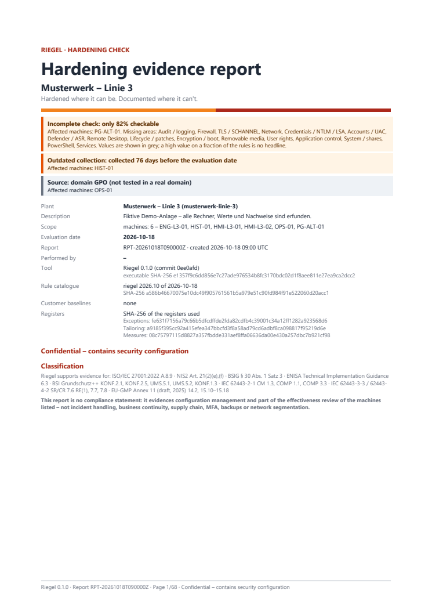 | 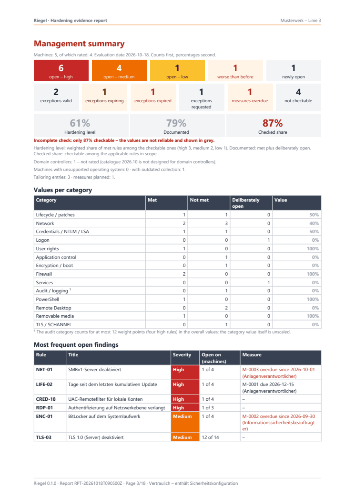 |
| Plant report, cover with banners, hashes and classification | Management summary (one page) |
| 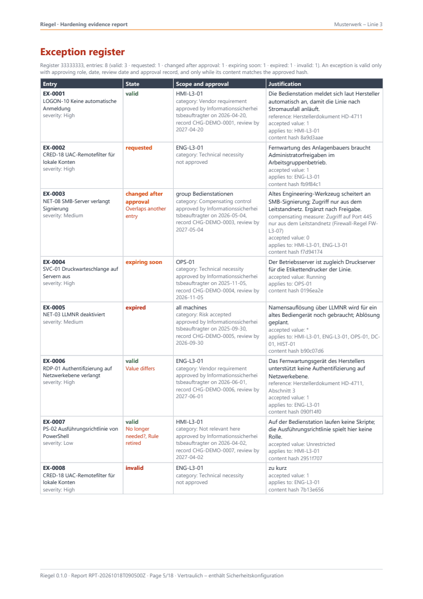 | 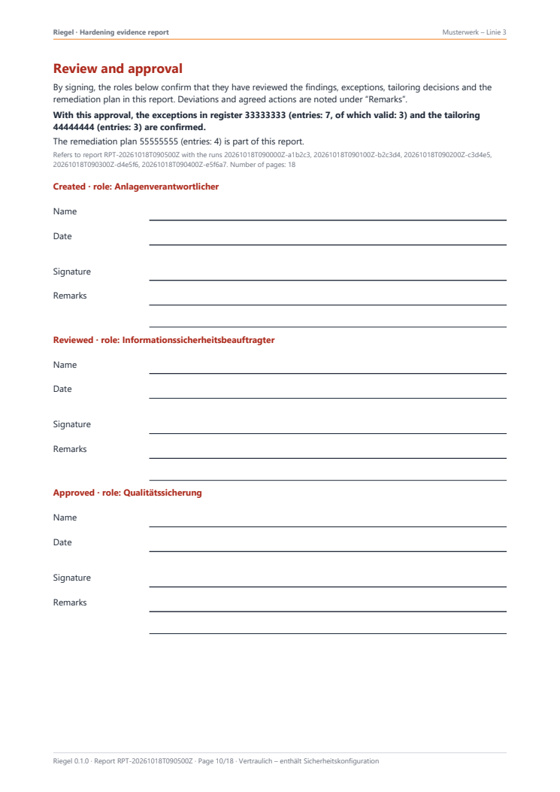 |
| Exception register with every entry state | Review and approval with the register binding sentence |
| 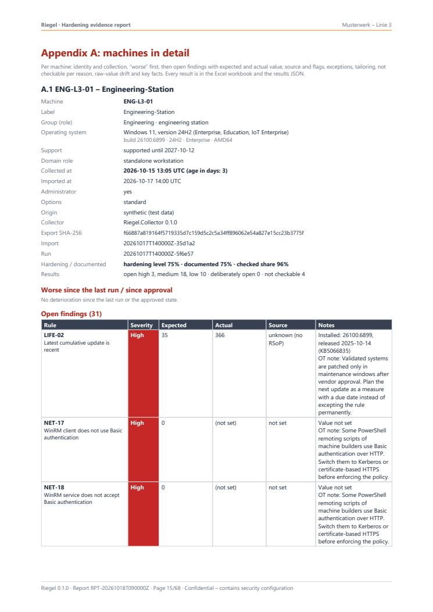 | 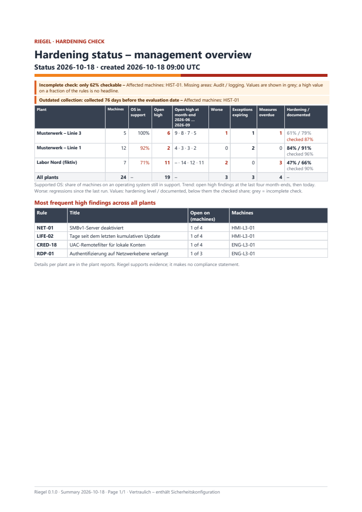 |
| Appendix A, one machine | Management one-pager |
| 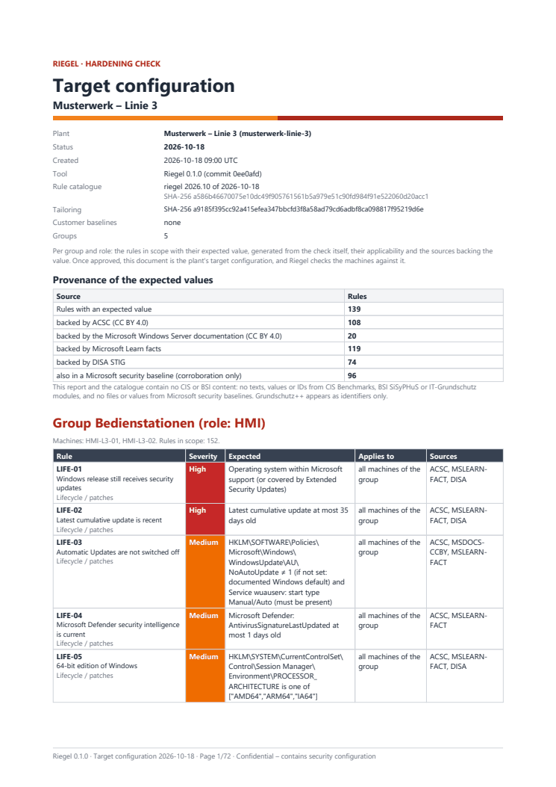 | 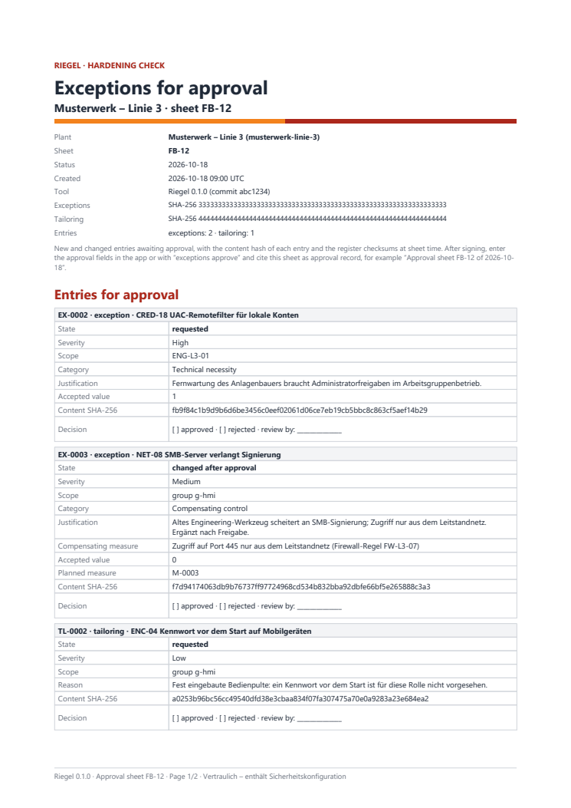 |
| Target configuration | Exceptions for approval |
| 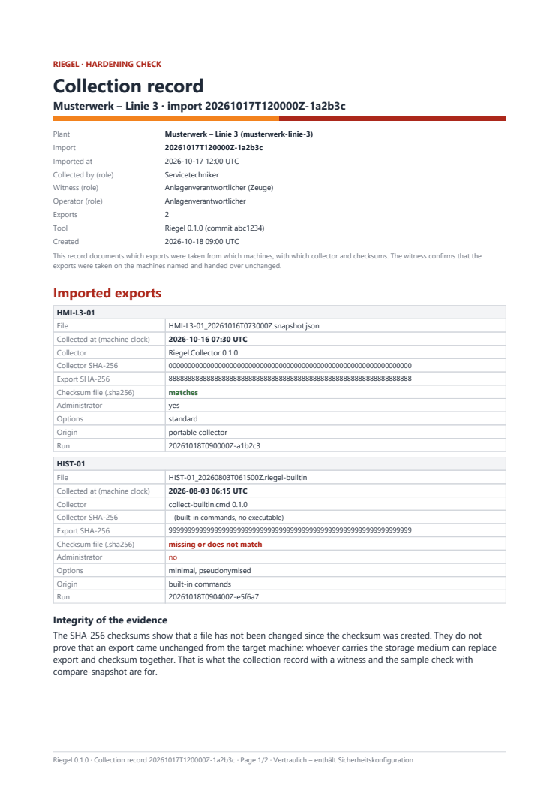 | 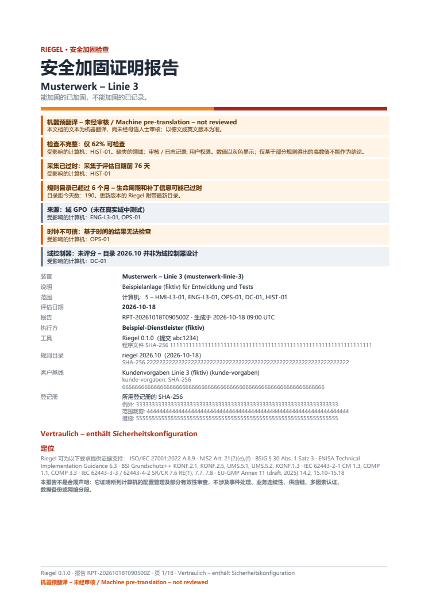 |
| Collection record | Cover in zh-Hans (Microsoft YaHei, with the pre-translation marking) |

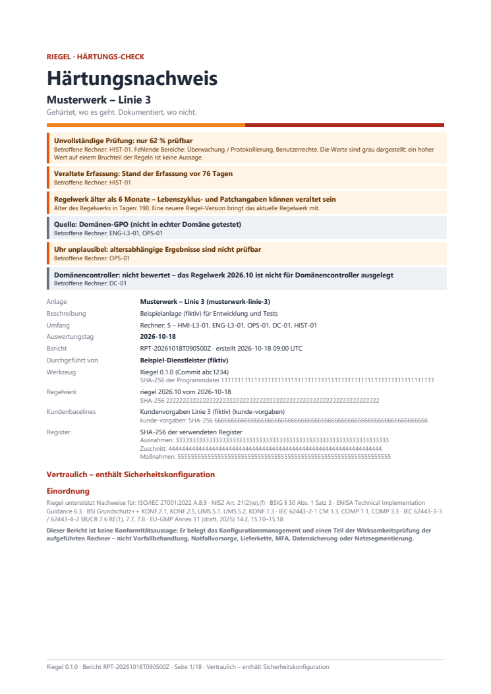

**Re-rendering the pages** (development machine only; nothing of this is shipped): write the documents, for example
with `dotnet run --project src/Riegel -c Release -- --demo-report out/demo` (set `RIEGEL_LANGUAGE` for the German and
Chinese covers), then render pages with [pypdfium2](https://pypi.org/project/pypdfium2/) (the pages above: 5.14.0,
licence "BSD-3-Clause, Apache-2.0, dependency licenses" per its package metadata) in a virtual environment:

```bash
python -m venv .venv && .venv/bin/python -m pip install pypdfium2 pillow
.venv/bin/python -c 'import pypdfium2 as p; d = p.PdfDocument("out/demo/Riegel-Report_Musterwerk-Linie-3_2026-10-18.pdf"); d[0].render(scale=1.25).to_pil().convert("P", palette=1, colors=256).save("docs/assets/reports/report-cover-en.png", optimize=True)'
```

Do not use PyMuPDF for this (AGPL).

## Implementation notes

- **One layout at a time.** MigraDoc 6.2.4 keeps the last used font in static fields without a lock (found in
  Zutritt), so rendering runs under `PdfWriter.RenderGate`; the layout tests format under the same lock.
- **Render first, then write.** The whole document is rendered before the file is created; a rendering error leaves
  the target untouched.
- **Metadata:** title, author "Riegel", subject (plant, host), keywords (report or sheet ID), creator
  "Riegel `<version>`", creation and modification date = the data's `GeneratedAtUtc`, document language.
- **Hostile text** from exports and registers (control characters, lone surrogates, very long words) is cleaned and
  broken before layout; tests render such input.
- **Tests:** `tests/Riegel.Tests/Reports/Pdf` checks structure and text in the MigraDoc document (`PdfDom`), page
  breaks and table splits in the formatted document (`PdfLayout`), and fonts, Unicode mapping and page counts in the
  written PDF. They need a system font and are skipped without one.
