[Riegel](../README.md) › Using the app

# Using the app

**Contents:** [Start](#start) · [Machines](#machines) · [Results](#results) · [Exceptions](#exceptions) ·
[Tailoring](#tailoring) · [Measures](#measures) · [Comparison](#comparison) · [Reports](#reports) ·
[Rule catalogue](#rule-catalogue) · [Settings](#settings) · [About](#about) · [Keyboard](#keyboard) ·
[Demo plant](#demo-plant) · [Start options](#start-options)

`Riegel.exe` without arguments opens the window. It reads configuration and writes only into the plant folder, the
output folder you choose and its own data folder; it changes no configuration and opens no network connections.
The window follows the Windows light or dark theme (or the one chosen in [Settings](#settings)) and every action can be
reached with the keyboard.

All pictures on this page show the fictitious [demo plant](#demo-plant) "Musterwerk – Linie 3" – no real machine,
customer or person. Each page has a light and a dark picture in [`assets/screenshots`](assets/screenshots).

## Start

<picture><source media="(prefers-color-scheme: dark)" srcset="assets/screenshots/start-dark.png">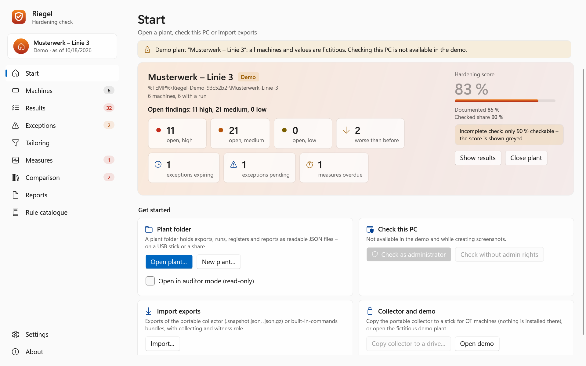</picture>

- **Plant folder:** *Open plant…* (Ctrl+O) opens a folder with `riegel-plant.json`; *New plant…* creates one in an
  empty folder (USB stick, share or local drive). *Open in auditor mode (read-only)* is for auditors who open a
  customer's folder: nothing is written into it, documents go only to a folder you choose.
- **Check this PC** (F5) reads this machine and imports the export into the open plant. *Check as administrator* asks
  Windows for elevation (UAC); *Check without admin rights* reads what a standard user can read – some rules then stay
  not checkable. Both are disabled in the demo and while screenshots are created, and in auditor mode.
- **Import exports** (Ctrl+I) takes exports of the portable collector (`.snapshot.json`, `.snapshot.json.gz`) or a
  built-in-commands bundle folder. You can also drag files or folders onto the window. The import dialog asks for the
  collecting role and the witness role (roles, not names) and can write the collection record to sign.
- **Collector and demo:** *Copy collector to a drive…* copies the portable collector for OT machines (nothing is
  installed there); *Open demo* opens the demo plant.
- With a plant open, the card at the top shows open findings by severity, findings worse than before, expiring and
  pending exceptions, overdue measures, the hardening score, the documented share and the checked share. A check
  below the checkable threshold is marked *incomplete* and its score is shown greyed.

## Machines

<picture><source media="(prefers-color-scheme: dark)" srcset="assets/screenshots/machines-dark.png">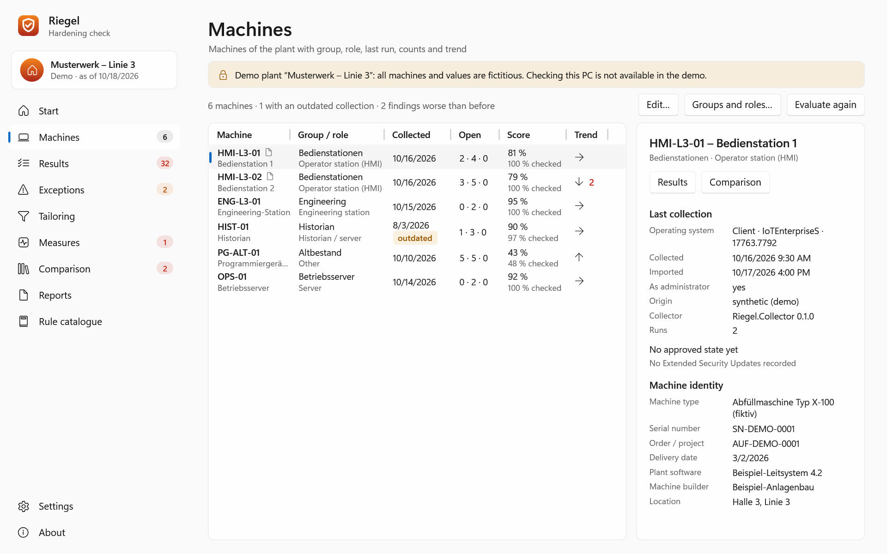</picture>

One row per machine: label, group and role, collection date (marked *outdated* after the plant's stale days), open
findings high · medium · low, score with checked share, trend against the previous run and the number of findings
worse than before. The page opens a machine on Enter or double-click in [Results](#results).

- *Edit…* sets the label, the group, Extended Security Updates (counts for the supported-OS rule), notes and the
  **machine identity** (machine type, serial number, order, delivery date, plant software, machine builder, location)
  used by the as-delivered report.
- *Groups and roles…* defines the groups and their role (operator station, engineering station, historian/server,
  server, office PC, jump host, other). Tailoring and the target configuration apply per role.
- *Evaluate again* evaluates the newest export of each machine again with the current registers; the export itself
  stays the same.

The detail pane shows the last collection (operating system, collected, imported, administrator rights, origin,
collector version, number of runs, notes such as an outdated collection) and the approved state.

## Results

<picture><source media="(prefers-color-scheme: dark)" srcset="assets/screenshots/results-dark.png">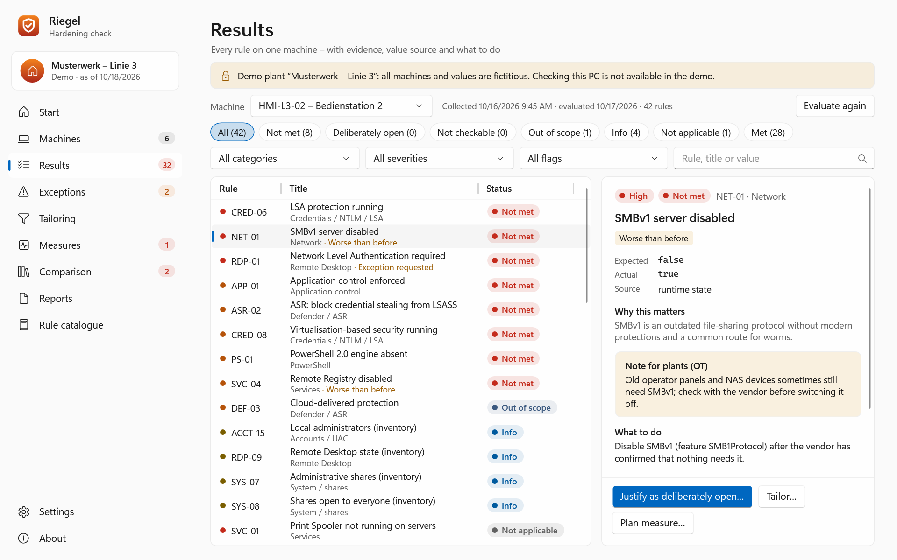</picture>

Every rule on one machine. Filter by status (not met, deliberately open, not checkable, out of scope, info, not
applicable, met), category, severity and flag, or search rule, title or value (Ctrl+F). The second line of a row shows
the category and flags such as *Worse than before* or *Exception requested*.

The detail pane shows severity and status, expected and actual value, **where the value comes from** (domain GPO –
experimental –, local policy, MDM, set directly, OS default, runtime state, not set), why the rule matters, the note
for plants (OT), what to do, references, the evidence that was read and register entries that apply.

- *Justify as deliberately open…* (Ctrl+E) creates an exception. The dialog is prefilled from the rule catalogue
  (OT note as justification, suggested reason) and takes the actual value as accepted value – check and adapt it.
- *Tailor…* records that the rule is not part of this role's target configuration.
- *Plan measure…* adds a remediation measure with owner role, due date and ticket.

<picture><source media="(prefers-color-scheme: dark)" srcset="assets/screenshots/exception-dialog-dark.png">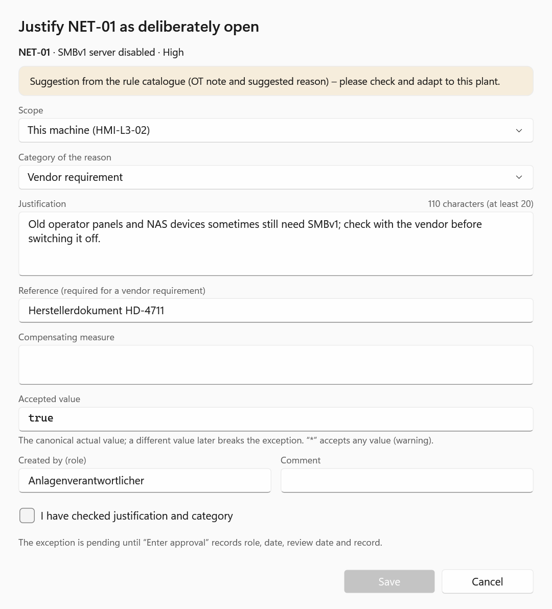</picture>

An exception needs a justification of at least 20 characters, a reference for a vendor requirement and the
compensating measure for a compensating control. It is *pending* until its approval is entered.

## Exceptions

<picture><source media="(prefers-color-scheme: dark)" srcset="assets/screenshots/exceptions-dark.png">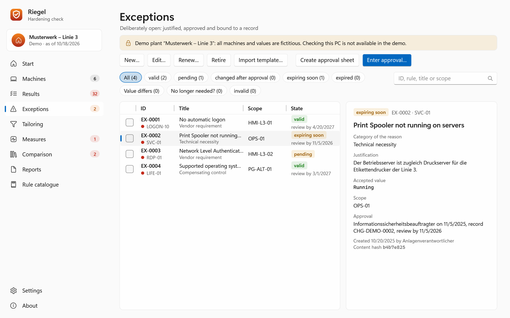</picture>

The register of deliberately open findings. Filter by state – valid, pending, changed after approval, expiring soon,
expired, value differs, no longer needed?, invalid – or search ID, rule, title or scope.

- Space marks the selected entry, Enter edits it.
- *Create approval sheet* writes a PDF with the marked entries (otherwise all pending and changed ones), their content
  hash and signature lines.
- *Enter approval…* records what the signed sheet or the change record says: approving role, date, review date,
  approval record and optionally a name. The approval is bound to the current content of each entry – a later change
  makes the entry *changed after approval*.

<picture><source media="(prefers-color-scheme: dark)" srcset="assets/screenshots/approval-dialog-dark.png">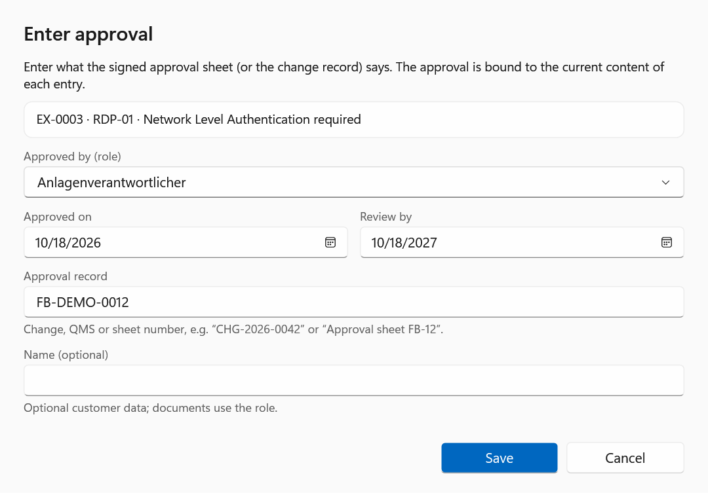</picture>

- *Renew…* approves an unchanged entry again with a new review date; *Retire* removes it (the history keeps the
  previous version); *Import template…* adds entries from an exceptions or tailoring template as pending.

The review date may be at most 36 months after the approval; more than 12 months gives a warning.

## Tailoring

<picture><source media="(prefers-color-scheme: dark)" srcset="assets/screenshots/tailoring-dark.png">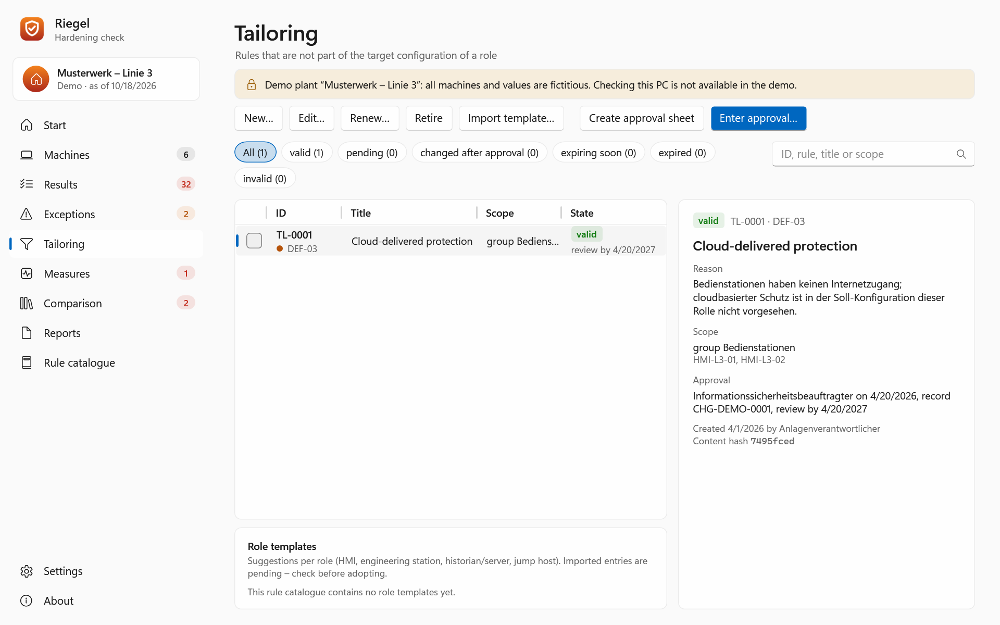</picture>

Rules that are not part of the target configuration of a role leave both scores. Use an exception for accepted risks
instead. The page works like [Exceptions](#exceptions) (approval sheet, approval, renew, retire) and offers the **role
templates** of the rule catalogue (operator station, engineering station, historian/server, jump host); imported
entries are pending until approved.

## Measures

<picture><source media="(prefers-color-scheme: dark)" srcset="assets/screenshots/measures-dark.png">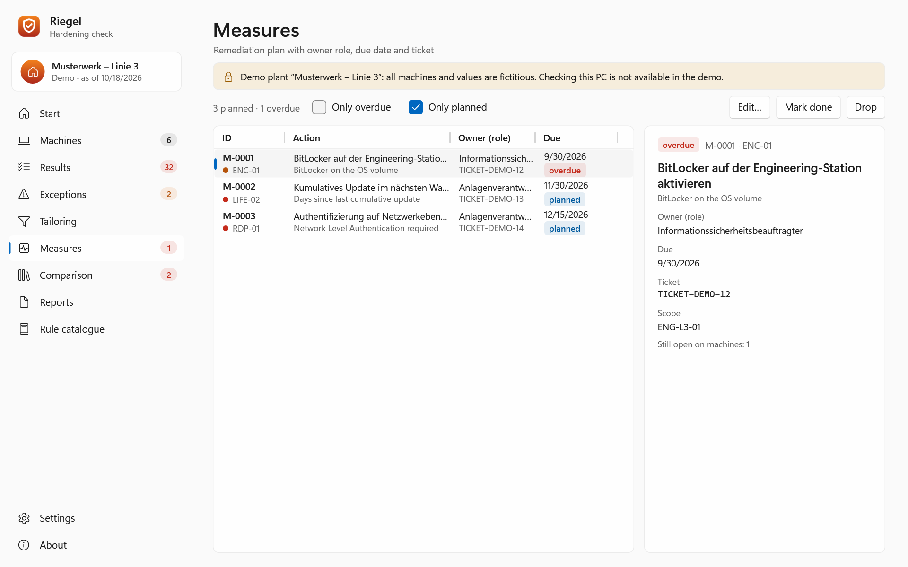</picture>

The remediation plan: action, owner role, due date, ticket and state. A finding with a measure stays open and is
flagged *remediation planned*; a passed due date counts as *overdue*. Filter *Only overdue* or *Only planned*; *Mark
done* and *Drop* close a measure.

## Comparison

<picture><source media="(prefers-color-scheme: dark)" srcset="assets/screenshots/comparison-dark.png">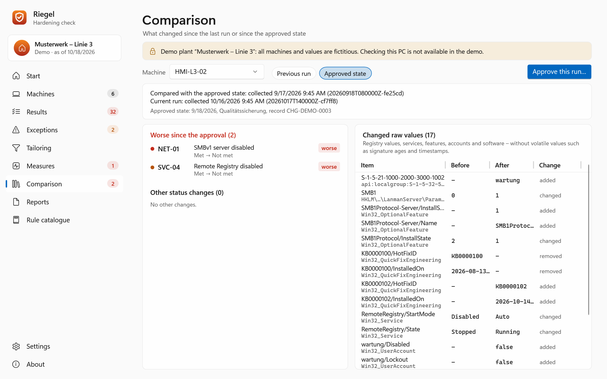</picture>

Compares the newest run of a machine with the **previous run** or with the **approved state**. Findings that got worse
come first, then other status changes and the changed raw values (registry values, services, features, accounts and
software, without volatile values such as signature ages and timestamps).

*Approve this run…* records the current run as approved state after commissioning, SAT or a vendor visit (role, date,
record). Later runs are compared with it; "worse since approval" is what monitoring reports.

## Reports

<picture><source media="(prefers-color-scheme: dark)" srcset="assets/screenshots/reports-dark.png">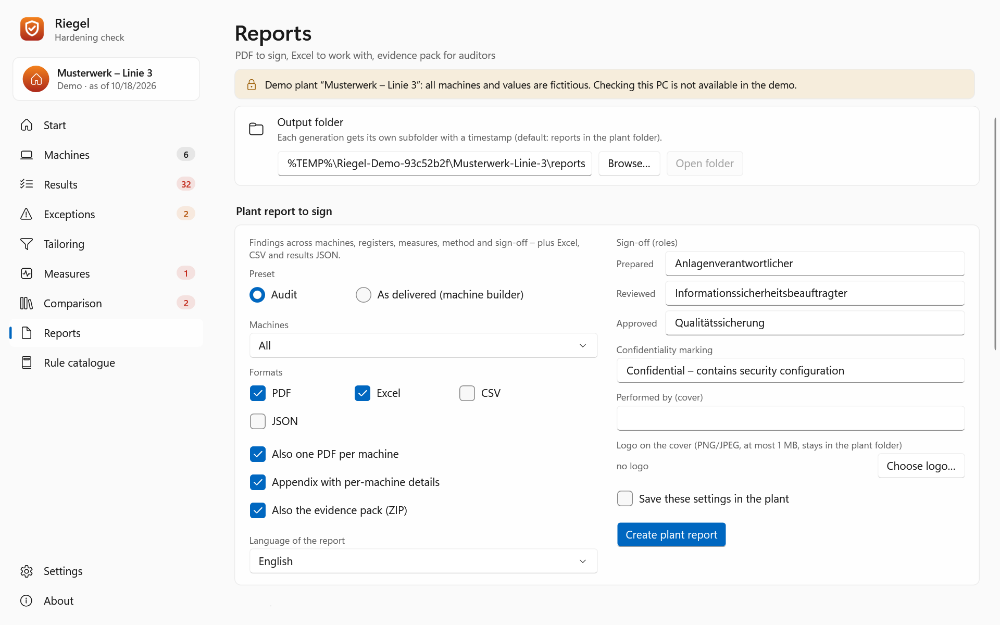</picture>

Every generation writes into its own timestamped subfolder of the output folder (default: `reports` in the plant
folder; in auditor mode you must choose a folder outside it). Ctrl+R jumps to *Create plant report*.

| Document | What it is |
|---|---|
| Plant report | PDF to sign with findings across machines, registers, measures, method and sign-off, plus Excel, CSV and results JSON; preset *Audit* or *As delivered (machine builder)*; optional one PDF per machine, appendix and evidence pack |
| Management one-pager | one A4 page across plants: counts, trend, regressions, expiring exceptions, overdue measures |
| Target configuration | rules in scope per group and role with expected values and tailoring – PDF and Excel to adopt and sign |
| Exceptions for approval | pending and changed entries with content hash and signature lines |
| Collection record | per import: who collected, witness, collector version and checksums – to sign (chain of custody) |
| Evidence pack | ZIP with manifest, checksums, runs, exports, registers and catalogue; auditors re-evaluate it with `verify`. The content of imported baselines is only included when you tick it – licence terms of SCT, BSI or CIS may forbid passing it on |
| Remediation proposal | per machine `.reg` with rollback, `GptTmpl.inf`, `audit.csv` and README – only files, Riegel never applies anything |
| Collector hand-over | the collector bundle with `UEBERGABE.txt` (checksums, version, how to run it, what it leaves behind) |

Report language, sign-off roles, confidentiality marking, "performed by" and a cover logo (PNG/JPEG, at most 1 MB,
kept in the plant folder) can be saved in the plant. Languages other than English and German are machine
pre-translations; the document says so on the cover and in every footer.

## Rule catalogue

<picture><source media="(prefers-color-scheme: dark)" srcset="assets/screenshots/catalogue-dark.png">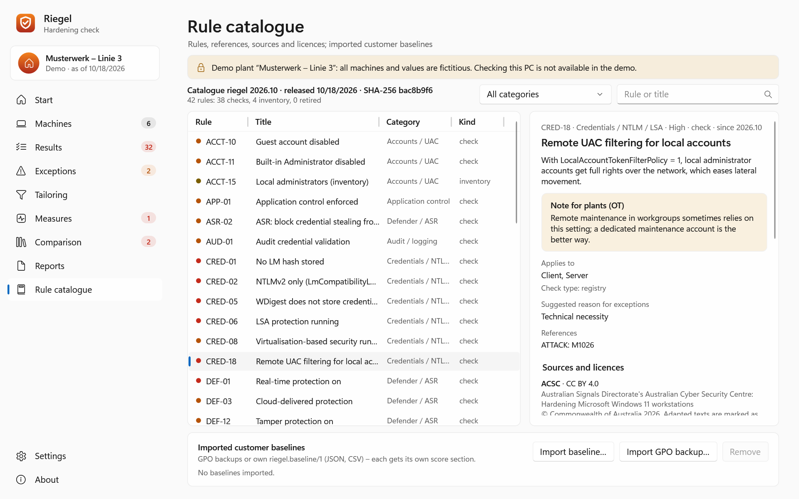</picture>

All rules with category, kind (check or inventory), severity, applicability, check type, suggested reason for
exceptions, references and the sources and licences of the texts. *Imported customer baselines* takes a GPO backup
folder or an own `riegel.baseline/1` file (JSON or CSV); each baseline gets its own score section.

## Settings

<picture><source media="(prefers-color-scheme: dark)" srcset="assets/screenshots/settings-dark.png">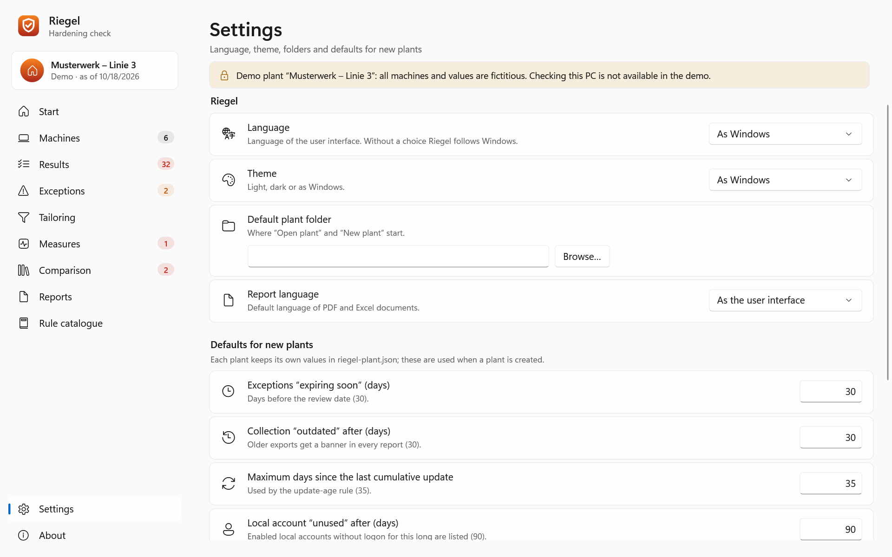</picture>

Language, theme, default plant folder, report language and the defaults for new plants. Values set for all users
through `defaults.json` (GPO/Intune) are marked *preset*. With a plant open, the lower part edits that plant's own
values in `riegel-plant.json` (only when you press *Save in the plant*). Details: [Settings](settings.md).

## About

<picture><source media="(prefers-color-scheme: dark)" srcset="assets/screenshots/about-dark.png">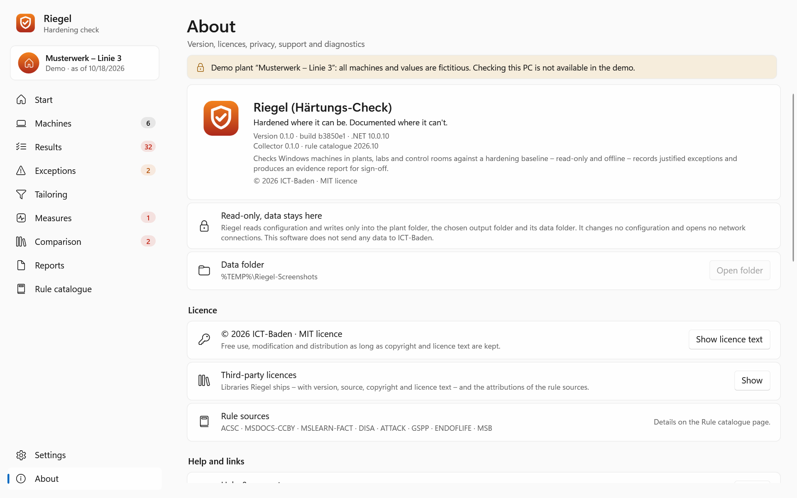</picture>

Version, build and collector version, rule catalogue version, the MIT licence text, third-party licences and the
attributions of the rule sources, the data folder, links (help and support, source code, privacy, legal notice,
website, this documentation – F1), the command line with its exit codes and the keyboard shortcuts.

*Create diagnostics package* saves version, system details and the log of the last 7 days as a ZIP for support –
never exports, registers or reports. *Without names and addresses* (on by default) removes names, paths and addresses,
including the host names of the open plant.

## Keyboard

| Keys | Action |
|---|---|
| Ctrl+O | open plant |
| Ctrl+I | import exports |
| F5 | check this PC (disabled in the demo) |
| Ctrl+E | justify the selected result as deliberately open |
| Ctrl+R | Reports, focus on *Create plant report* |
| Ctrl+F | search on the current page |
| Ctrl+1 … Ctrl+9 | pages in the order of the navigation |
| F1 | this documentation |
| Space / Enter | mark / edit an entry in the registers |

Shortcuts need exactly Ctrl (or no modifier for F-keys): AltGr, which Windows reports as Ctrl+Alt, never triggers them,
so typing `€`, `@` or `{[]}` on a German keyboard in a text field does nothing unexpected. Tab and Shift+Tab move
through every control; lists are operated with the arrow keys.

## Demo plant

`Riegel.exe --demo` (or *Open demo* on the start page) builds the fictitious plant "Musterwerk – Linie 3" in a
temporary folder from embedded synthetic exports – two runs per machine – and evaluates them with the normal services:

| Machine | System | Shows |
|---|---|---|
| `HMI-L3-01` | Windows 10 IoT LTSC 2019 | autologon exception, tailoring of cloud protection |
| `HMI-L3-02` | Windows 10 IoT LTSC 2019 | regression against the approved state, pending exception |
| `ENG-L3-01` | Windows 11 24H2 | third-party antivirus (Defender passive), overdue measure |
| `HIST-01` | Server 2016 | end of support near, outdated collection |
| `PG-ALT-01` | Windows 7 SP1, built-in bundle | many rules not checkable |
| `OPS-01` | Server 2022, domain member | experimental GPO attribution, expiring exception |

Registers use roles only and obviously fictitious references ("Herstellerdokument HD-4711", vendor
"Beispiel-Anlagenbau", record "CHG-DEMO-0001"). Checking this PC is disabled in the demo. The folder is deleted when
Riegel closes.

## Start options

| Command | Effect |
|---|---|
| `Riegel.exe` | window (one instance per Windows session; a second start brings it to the front) |
| `Riegel.exe --demo` | window with the demo plant |
| `Riegel.exe <command> …` | the command line, e.g. `Riegel.exe --version` – the console does not wait for the window program; in scripts use `Riegel.Cli.exe` |
| `Riegel.exe --screenshots <folder> [--theme light\|dark\|both]` | renders every page with the demo plant as `<page>-light.png` / `<page>-dark.png` (for the documentation; needs a signed-in Windows session) |

The pictures on this page are made with [`tools/screenshots/make-assets.ps1`](../tools/screenshots/make-assets.ps1).
